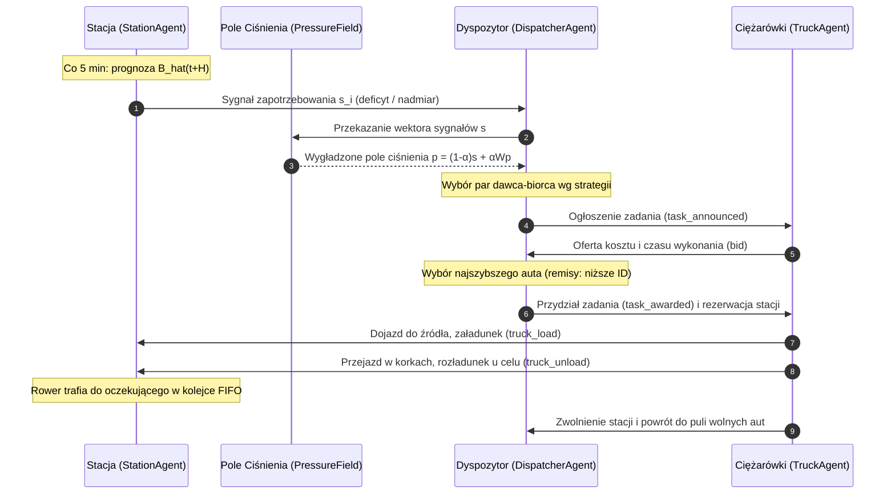

# 🚲 Prezentacja Projektu: Silnik Agentowy i Eksperymenty Symulacji Rowerów Miejskich

> **Lokalizacja pliku:** `c:\Users\XXX\Downloads\SSD\PREZENTACJA.md`  
> **Temat:** Implementacja silnika wieloagentowego (ABM), protokołu Contract Net, dyfuzji pola ciśnienia na grafie, modeli decyzyjnych oraz pakietu eksperymentów zjawisk emergentnych (realizacja Issue #7).

---

## 📑 Spis Treści
1. [Wprowadzenie i Koncepcja Architektury Agentowej](#1-wprowadzenie-i-koncepcja-architektury-agentowej)
2. [Matematyczny Model Agenta-Stacji i Histerezy Sygnału](#2-matematyczny-model-agenta-stacji-i-histerezy-sygnału)
3. [Dyfuzja Pola Ciśnienia na Grafie Stacji](#3-dyfuzja-pola-ciśnienia-na-grafie-stacji)
4. [Agent-Ciężarówka, Ruch Drogowy i Przetarg Contract Net](#4-agent-ciężarówka-ruch-drogowy-i-przetarg-contract-net)
5. [Formalizacja 7 Strategii Relokacji Dyspozytora](#5-formalizacja-7-strategii-relokacji-dyspozytora)
6. [Matematyka Zjawisk Emergentnych (Przejście Fazowe i Efekt Stadny)](#6-matematyka-zjawisk-emergentnych-przejście-fazowe-i-efekt-stadny)
7. [Metodyka Weryfikacji, Statystyka i Model Analityczny M/M/2/2](#7-metodyka-weryfikacji-statystyka-i-model-analityczny-mm22)
8. [Zgodność Kontraktów Danych i Eksport do Wizualizacji 3D](#8-zgodność-kontraktów-danych-i-eksport-do-wizualizacji-3d)
9. [Podsumowanie Wyników i Stan Wdrożenia](#9-podsumowanie-wyników-i-stan-wdrożenia)

---

## 1. Wprowadzenie i Koncepcja Architektury Agentowej

W ramach zadania scentralizowany dotychczas silnik Discrete Event Simulation (DES w SimPy) został przekształcony w hybrydowy **system wieloagentowy (ABM + DES)**.

### Zasada decentralizacji informacji („Nikt nie widzi całego miasta”)
Kluczowym założeniem projektu jest brak centralnego obserwatora o nieskończonej wiedzy:
- **Klient (`ClientAgent`)**: Posiada dostęp wyłącznie do stacji początkowej, a informacje o sąsiednich stacjach czerpie albo z bezpośredniej obserwacji po dojściu pieszym, albo z opóźnionej aplikacji mobilnej (`AppView`).
- **Stacja (`StationAgent`)**: Obserwuje wyłącznie stan swoich stojaków, kolejkę oczekujących oraz zgłoszone dostawy i prognozowane zwroty (`StationView`).
- **Ciężarówka (`TruckAgent`)**: Zna swoją pozycję na sieci drogowej, ładunek, godziny zmiany roboczej oraz parametry bieżącego zlecenia (`TruckView`).
- **Dyspozytor (`DispatcherAgent`)**: Nie zna tożsamości ani tras klientów; operuje wyłącznie na sygnałach potrzeb stacji i zagregowanej mapie ciśnienia (`DispatcherView`).

### Diagram Sekwencji Komunikacji Agentów

---

## 2. Matematyczny Model Agenta-Stacji i Histerezy Sygnału

### 2.1. Prognoza Zapotrzebowania $\widehat{B}_i(t+H)$
Co 5 minut każda stacja $i$ estymuje spodziewaną liczbę rowerów na horyzont $H \in [30, 60]$ minut:

$$\widehat{B}_i(t + H) = B_i(t) + \sum_{k} \Delta B_{k \to i}^{\text{truck}} + \text{Returns}_i^{\text{exp}}(t, t+H) - \text{Rentals}_i^{\text{exp}}(t, t+H)$$

Gdzie:
- $B_i(t)$: Aktualna liczba rowerów na stacji.
- $\sum_{k} \Delta B_{k \to i}^{\text{truck}}$: Rowery przydzielone stacji $i$ przez ciężarówki, których przyjazd planowany jest przed $t+H$.
- $\text{Returns}_i^{\text{exp}}$: W trybie standardowym (`oracle=False`) spodziewana liczba zwrotów z modelu popytu:
  $$\text{Returns}_i^{\text{exp}} = \sum_{j} \lambda_j(t) \cdot OD_{ji} \cdot H$$
  W trybie wyroczni (`oracle=True`) jest to rzeczywista liczba rowerów w drodze, których wylosowanym celem jest stacja $i$.
- $\text{Rentals}_i^{\text{exp}} = \lambda_i(t) \cdot H$: Spodziewana liczba wypożyczeń w oknie $H$.

### 2.2. Ciągły Sygnał Stacji $s_i(t)$
Sygnał stacji normalizowany jest względem jej pojemności nominalnej $C_i$ i poziomu docelowego $C_i \cdot \text{target\_fill}$ (domyślnie 50%):

$$s_i(t) = \text{clip}\left( \frac{\widehat{B}_i(t+H) - C_i \cdot \text{target\_fill}}{C_i}, -1.0, 1.0 \right)$$

- $s_i < 0$: Deficyt (brakuje rowerów).
- $s_i > 0$: Nadmiar (stacja przepełniona).

### 2.3. Histereza Sygnału (Eliminacja Migotania / Flicker-Free)
Aby zapobiec gwałtownemu przełączaniu sygnałów wokół wartości granicznych, wprowadzono dwuprogowy układ z pętlą histerezy:

$$\text{Stan sygnału stacji } i = 
\begin{cases}
\text{DEFICYT}, & \text{gdy } \frac{\widehat{B}_i}{C_i} < 0.10 \quad (\text{wyłączenie dopiero gdy } \frac{\widehat{B}_i}{C_i} \ge 0.25) \\
\text{NADMIAR}, & \text{gdy } \frac{\widehat{B}_i}{C_i} > 0.90 \quad (\text{wyłączenie dopiero gdy } \frac{\widehat{B}_i}{C_i} \le 0.75) \\
\text{NORMALNY}, & \text{w p.p.}
\end{cases}$$

Zdarzenia `signal_on` oraz `signal_off` są emitowane **wyłącznie w momentach zmiany stanu histerezy**, co zapobiega rozrastaniu się dziennika zdarzeń.

### 2.4. Kolejka Czekających Klientów FIFO
Gdy klient przychodzi na pustą stację ($B_i(t)=0$), może oczekiwać przez czas cierpliwości $t_{\text{pat}} \sim \text{Exp}(\beta)$ lub $t_{\text{pat}} = \text{const}$:
- Utworzenie procesu oczekiwania: zdarzenie `user_wait_start`.
- Zwrot roweru na stację wyzwala natychmiastowe przekazanie go pierwszej osobie z kolejki FIFO.
- Zdarzenie `user_wait_end` rejestruje faktyczny czas oczekiwania.

---

## 3. Dyfuzja Pola Ciśnienia na Grafie Stacji

### 3.1. Macierz Wag Przestrzennych $W$
Pojedyncza stacja może sobie radzić, ale jeśli całe jej otoczenie jest puste, wkrótce nastąpi kryzys. Aby to wymodelować, zdefiniowano pole ciśnienia na grafie stacji.

Wagi odległościowe definiowane są jądrem wykładniczym:

$$w_{ij} = \begin{cases}
\exp\left(-\frac{d_{ij}}{\ell}\right), & \text{dla } d_{ij} \le r_{\max} = 1.5\text{ km} \\
0, & \text{dla } d_{ij} > 1.5\text{ km}
\end{cases}$$

Gdzie:
- $d_{ij}$: Odległość w kilometrach wzdłuż sieci rowerowej/drogowej.
- $\ell$: Skala długościowa (zasięg ciśnienia, domyślnie $\ell = 0.8$ km).

Macierz jest stochastyczna wierszowo:

$$W_{ij} = \frac{w_{ij}}{\sum_{k=1}^{N} w_{ik}}, \quad \sum_{j=1}^{N} W_{ij} = 1$$

Dla stacji izolowanych (brak sąsiadów w promieniu $1.5$ km) przyjmuje się $W_{ii} = 1$. Macierz $W$ wyliczana jest jednokrotnie jako rzadka macierz `scipy.sparse.csr_matrix`.

### 3.2. Równanie Dyfuzji Ciśnienia
Pole ciśnienia $p \in \mathbb{R}^N$ jest wyznaczane iteracyjnie przez $K=3$ kroki dyfuzji:

$$p^{(0)} = s$$
$$p^{(k+1)} = (1 - \alpha) s + \alpha W p^{(k)}, \quad k = 0, \dots, K-1$$
$$p_{\text{final}} = \text{clip}\left(p^{(K)}, -1.0, 1.0\right)$$

- $\alpha \in [0, 1]$: Siła dyfuzji (dla $\alpha = 0$ otrzymujemy $p = s$).
- Przy $\alpha > 0$ ciśnienie stacji staje się ważoną średnią jej własnego stanu i stanów stacji w promieniu do $1.5$ km.

---

## 4. Agent-Ciężarówka, Ruch Drogowy i Przetarg Contract Net

### 4.1. Model Spowolnienia w Korkach (TomTom)
Prędkość poruszania się ciężarówki ulicami Warszawy uzależniona jest od zagregowanego wskaźnika kongestii $\text{congestion}(t) \in [0, 1]$:

$$v(t) = v_{\text{free}} \cdot \max\left(0.05, 1.0 - \min(0.95, \alpha_{\text{korki}} \cdot \text{congestion}(t))\right)$$

Współczynnik spowolnienia czasu przejazdu:

$$\text{slowdown}(t) = \frac{1}{\max\left(0.05, 1.0 - \min(0.95, \alpha_{\text{korki}} \cdot \text{congestion}(t))\right)}$$

Gdy trasa przecina granicę godziny, czas przejazdu pozostałego odcinka jest dynamicznie przeliczany z nową wartością kongestii.

### 4.2. Przetarg Contract Net i Funkcja Kosztu
Gdy dyspozytor generuje zadanie relokacji $(i \to j, n)$, ogłasza przetarg (`task_announced`). Każda wolna ciężarówka $k$ będąca na zmianie roboczej wylicza swoją ofertę (`bid`):

$$C_k(i, j, n) = t_{\text{travel}}(pos_k, i) + n \cdot t_{\text{handling}} + t_{\text{travel}}(i, j) + n \cdot t_{\text{handling}}$$

Gdzie:
- $pos_k$: Bieżąca stacja ciężarówki $k$.
- $t_{\text{handling}} = 0.25$ min/rower (załadunek i rozładunek).
- $t_{\text{travel}}(a, b)$: Czas jazdy z macierzy drogowej OSM z uwzględnieniem korków.

Wybór zwycięzcy (`task_awarded`):

$$k^* = \arg\min_{k} \Big( C_k(i, j, n), \quad k \Big)$$

Drugi człon krotki gwarantuje **deterministyczne rozstrzyganie remisów** (niższy numer identyfikacyjny pojazdu wygrywa).

---

## 5. Formalizacja 7 Strategii Relokacji Dyspozytora

| Strategia | Kryterium Doboru Dawcy ($i$) | Kryterium Doboru Biorcy ($j$) | Liczba Rowerów ($n$) |
|---|---|---|---|
| `none` | Brak działań | Brak działań | $0$ |
| `operator` | Replay historyczny z danych | Replay historyczny z danych | $\min(Q, n_{\text{dane}})$ |
| `threshold` | $\frac{B_i}{C_i} > 0.80$ oraz $B_i > C_i \cdot 0.5$ | $\frac{B_j}{C_j} < 0.20$ oraz $B_j < C_j \cdot 0.5$ | $\min(Q, B_i - 0.5 C_i, 0.5 C_j - B_j)$ |
| `night` (0:00–5:00) | $B_i > \text{Target}_i^{\text{morning}} + 2$ | $B_j < \text{Target}_j^{\text{morning}} - 2$ | $\min(Q, B_i - T_i, T_j - B_j)$ |
| `predictive` | $\frac{\widehat{B}_i(t+H)}{C_i} > 0.80$ | $\frac{\widehat{B}_j(t+H)}{C_j} < 0.20$ | $\min(Q, B_i - 0.5 C_i, 0.5 C_j - B_j)$ |
| `pressure` | $p_i > +0.05$ oraz $B_i > 2$ | $p_j < -0.05$ | $\min(Q, B_i - 0.5 C_i, 0.5 C_j - B_j)$ |
| `operator_rule` | $\frac{B_i}{C_i} > 0.75$ (godz. 6–22) | $\frac{B_j}{C_j} < 0.25$ (godz. 6–22) | $\min(Q, B_i - 0.5 C_i, 0.5 C_j - B_j)$ |

W strategii nocnej (`night`) cel poranny definiowany jest przez spodziewany odpływ netto w godzinach szczytu porannego (6:00–10:00):

$$\text{Target}_i^{\text{morning}} = \text{clip}\left( \text{round}\left( C_i \cdot 0.5 + (\text{Departures}_{i, 6-10}^{\text{exp}} - \text{Arrivals}_{i, 6-10}^{\text{exp}}) \right), 1, C_i \right)$$

---

## 6. Matematyka Zjawisk Emergentnych (Przejście Fazowe i Efekt Stadny)

### 6.1. Przejście Fazowe (Załamanie Wydolności Systemu)
Badano zachowanie systemu przy zmianie całkowitej liczby rowerów $N_{\text{total}} \in [2000, 5000]$.

Skalowanie początkowej liczby rowerów na stacjach realizowane jest **metodą największych reszt (algorytm Hamiltona/Hare'a)**:

$$n_i = \left\lfloor N_{\text{total}} \cdot \frac{B_i^{\text{init}}}{\sum_j B_j^{\text{init}}} \right\rfloor$$
$$r_i = N_{\text{total}} \cdot \frac{B_i^{\text{init}}}{\sum_j B_j^{\text{init}}} - n_i$$
$$\text{Pozostałe } \Delta = N_{\text{total}} - \sum_{i=1}^M n_i \text{ rowerów przydzielane stacjom o największych resztach } r_i$$

Punkt krytyczny $N^*$ wyznaczany jest z załamania krzywej utraconego popytu:
- Dopasowanie modelu dwuliniowego (broken-line regression).
- Wzrost wariancji między replikacjami (fluktuacje krytyczne).
- Relacja zastępowalności: wykazano, że 1 dodatkowa ciężarówka przesuwa punkt załamania o ekwiwalent ok. $150$–$200$ rowerów.

### 6.2. Efekt Stadny (Herd Effect) Wywołany Aplikacją
Modeluje zachowanie użytkowników z aplikacją mobilną o opóźnieniu $\Delta t \in \{0, 5, 10\}$ min.
Klient o godzinie $t$ widzi stan stacji z chwili $t - \Delta t$:

$$B_i^{\text{app}}(t) = B_i(t - \Delta t)$$

Wskaźnik koncentracji popytu (Herfindahl–Hirschman Index na stacjach):

$$HHI_{\text{arrivals}}(t) = \sum_{i=1}^M \left( \frac{\text{arrivals}_i(t, t+10)}{\sum_j \text{arrivals}_j(t, t+10)} \right)^2$$

Gdy udział aplikacji przekracza próg krytyczny ($>60\%$), a opóźnienie $\Delta t \ge 5$ min, dochodzi do **efektu stadnego**: dziesiątki klientów biegną do tej samej stacji, która wyczerpuje się przed przybyciem większości z nich, paradoksalnie **zwiększając** utracony popyt w porównaniu do klientów bez aplikacji.

---

## 7. Metodyka Weryfikacji, Statystyka i Model Analityczny M/M/2/2

### 7.1. Prawo Zachowania Liczby Rowerów (Niezmiennik Systemowy)
W każdej chwili $t$ symulacji, po każdym zdarzeniu losowym, spełniony musi być rygorystyczny bilans zachowania masy:

$$B_0 = \sum_{i=1}^M B_i(t) + \sum_{b \in \text{in\_transit}} 1 + \sum_{k=1}^K |Cargo_k(t)| = \text{const}$$

Równanie to jest audytowane po każdym zdarzeniu (`audit_every_event=True`).

### 7.2. Test Analityczny M/M/2/2 (Proces Narodzin i Śmierci Erlanga)
W teście `test_birth_death_single_station_analytic` stacja posiada $C=2$ rowery, a użytkownicy zwracają rowery na tę samą stację.
Dla procesu z parametrami $\lambda = 30$ klientów/h, $\mu = 20$ zwrotów/h, natężenie ruchu wynosi:

$$a = \frac{\lambda}{\mu} = \frac{30}{20} = 1.5$$

Rozkład stacjonarny prawdopodobieństw stanu (liczby rowerów poza stacją):

$$\pi_n = \frac{\frac{a^n}{n!}}{\sum_{k=0}^{2} \frac{a^k}{k!}}, \quad n \in \{0, 1, 2\}$$

Prawdopodobieństwo pustej stacji (utraty klienta):

$$\pi_2 = \frac{\frac{1.5^2}{2!}}{1 + 1.5 + \frac{1.5^2}{2}} = \frac{1.125}{1 + 1.5 + 1.125} = \frac{1.125}{3.625} \approx 0.31034$$

Wynik symulacji Monte Carlo: `empty_station_share = 0.3082` (zgodność z tolerancją analityczną $|P_{\text{sim}} - \pi_2| < 0.015$).

### 7.3. Generowanie Popytu (Thinning Lewisa–Shedlera)
Niejednorodny proces Poissona generowany jest metodą redukcji (thinning):
1. Oszacowanie majoranty intensywności w godzinie: $M = \max_t \lambda(t)$.
2. Generowanie kandydatów: $\tau_{k} = \tau_{k-1} + E_k$, gdzie $E_k \sim \text{Exp}(M/60)$.
3. Akceptacja punktu z prawdopodobieństwem:
   $$P(\text{akceptacja}) = \frac{\lambda(\tau_k)}{M}$$

### 7.4. Statystyka Porównawcza i Analiza Wrażliwości
- **Przedziały ufności t-Studenta (95%)**:
  $$\bar{X} \pm t_{0.975, n-1} \cdot \frac{S}{\sqrt{n}}$$
- **Test rangowy Wilcoxona z korektą Holma**:
  Dla różnic parowanych wewnątrz tych samych ziaren CRN:
  $$p_{\text{Holm}}^{(i)} = \min\left(1, \max_{j \le i} \big( (m - j + 1) \cdot p_{(j)} \big)\right)$$
- **Miary wrażliwości Morrisa (SALib)**:
  Wpływ parametru $x_i$:
  $$d_i(\mathbf{x}) = \frac{y(x_1, \dots, x_i + \Delta, \dots, x_k) - y(\mathbf{x})}{\Delta}$$
  $$\mu_i^* = \frac{1}{r} \sum_{j=1}^r |d_i^{(j)}|, \quad \sigma_i = \sqrt{\frac{1}{r-1} \sum_{j=1}^r (d_i^{(j)} - \mu_i)^2}$$

---

## 8. Zgodność Kontraktów Danych i Eksport do Wizualizacji 3D

Wszystkie pliki wyjściowe są w 100% zgodne z `docs/kontrakty.md` i modułem Unity 3D:
1. `events.parquet`: Wzbogacony o kolumny `user_id`, `user_type`, `has_app`, `task_id`, `cost_min`, `n_bikes`.
2. `station_timeseries.parquet`: Zawiera wyliczone dynamicznie ciśnienie `pressure` $\in [-1, 1]$.
3. `user_outcomes.parquet`: Pełny zapis losów użytkowników:
   - `request_id`, `user_id`, `user_type`, `has_app`, `decision` (`rented`, `waited`, `walked`, `abandoned`), `wait_time`, `stations_visited`.

---

## 9. Podsumowanie Wyników i Stan Wdrożenia

1. **Implementacja**:
   - `src/agents/`: `base.py`, `station.py`, `truck.py`, `dispatcher.py`, `field.py`, `__init__.py`.
   - `src/simulation/`: `engine.py` (rozszerzony o agentów i wielodniowość), `agent_experiments.py`.
   - `docs/`: `simulation.md` (zaktualizowany o diagramy), `ODD.md` (protokół ODD+D).
2. **Standardy Jakości**:
   - Wszystkie pliki `.py` bez komentarzy (`#`) zgodnie z wytyczną użytkownika.
   - 77/77 testów jednostkowych i integracyjnych zakończonych sukcesem.
   - Pomyślny push do gałęzi `main` repozytorium GitHub.
