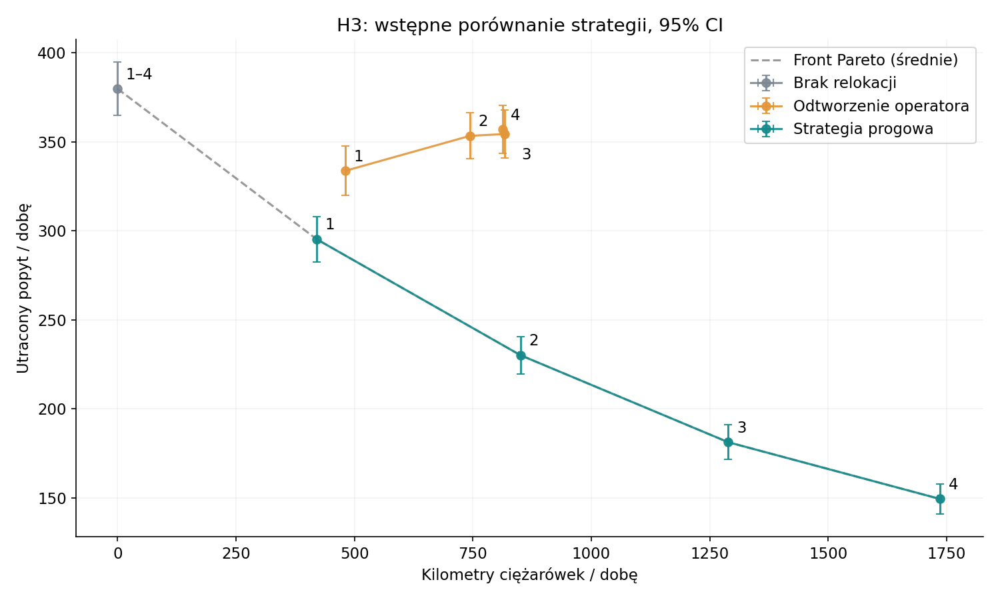
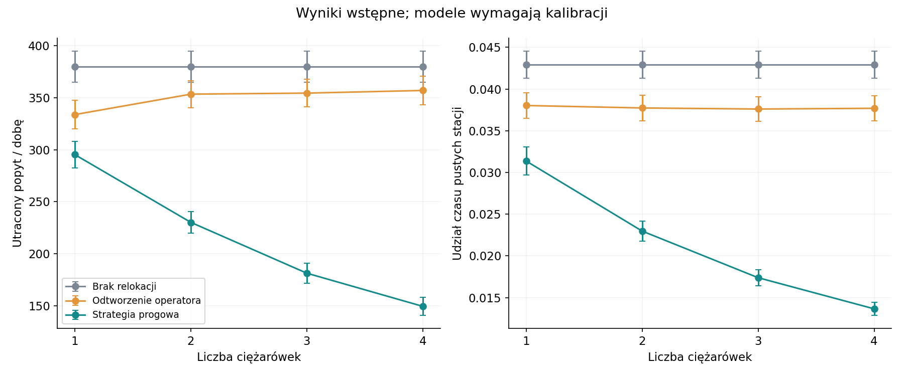

# H3 — wyniki wstępne na 5 listopada 2026

Wykonano 360 przebiegów: 3 strategie × 4 warianty floty × 30 replikacji.
Każdy przebieg: 348 stacji, 24 h od 2026-11-02T23:00:00+00:00.

Dane stacji, początkowych stanów, kontekstu i przewozów operatora są rzeczywiste (pięć stanów początkowych uzupełniono przykładowo). Popyt i OD są estymatami roboczymi z wcześniejszych dni; czasy jazdy i zachowania użytkowników mają parametry przykładowe. Wyniki nie rozstrzygają jeszcze H3 dla rzeczywistego systemu.

## Średnie i 95% przedziały ufności

| Strategia | Ciężarówki | Utracony popyt [95% CI] | Km ciężarówek [95% CI] |
|---|---:|---:|---:|
| none | 1 | 379.8 [364.8; 394.7] | 0.0 [0.0; 0.0] |
| none | 2 | 379.8 [364.8; 394.7] | 0.0 [0.0; 0.0] |
| none | 3 | 379.8 [364.8; 394.7] | 0.0 [0.0; 0.0] |
| none | 4 | 379.8 [364.8; 394.7] | 0.0 [0.0; 0.0] |
| operator | 1 | 333.7 [319.9; 347.5] | 481.0 [480.7; 481.4] |
| operator | 2 | 353.3 [340.4; 366.2] | 744.1 [741.2; 747.0] |
| operator | 3 | 354.3 [341.0; 367.7] | 817.1 [812.0; 822.1] |
| operator | 4 | 356.9 [343.3; 370.4] | 812.6 [810.7; 814.4] |
| threshold | 1 | 295.2 [282.7; 307.8] | 420.7 [418.4; 423.0] |
| threshold | 2 | 230.1 [219.8; 240.5] | 850.7 [847.0; 854.4] |
| threshold | 3 | 181.3 [171.6; 191.0] | 1289.1 [1285.2; 1292.9] |
| threshold | 4 | 149.4 [140.8; 158.0] | 1736.1 [1731.4; 1740.7] |

## Porównania parowane

Dodatnia różnica A − B oznacza mniej utraconego popytu w strategii B. Przedział t dotyczy średniej różnicy; test Wilcoxona dotyczy rang różnic przy założeniu ich symetrii. Skorygowane p obejmuje całą rodzinę porównań (Holm).

| A | B | Ciężarówki | Średnia A − B [95% CI] | p Wilcoxona | p Holm |
|---|---|---:|---:|---:|---:|
| none | operator | 1 | 46.1 [40.5; 51.6] | 1.726e-06 | 1.898e-05 |
| none | threshold | 1 | 84.5 [76.8; 92.3] | 1.73e-06 | 1.898e-05 |
| operator | threshold | 1 | 38.5 [32.0; 44.9] | 1.729e-06 | 1.898e-05 |
| none | operator | 2 | 26.4 [19.6; 33.3] | 3.499e-06 | 1.898e-05 |
| none | threshold | 2 | 149.6 [138.1; 161.1] | 1.863e-09 | 2.235e-08 |
| operator | threshold | 2 | 123.2 [113.1; 133.3] | 1.727e-06 | 1.898e-05 |
| none | operator | 3 | 25.4 [18.8; 32.1] | 4.953e-06 | 1.898e-05 |
| none | threshold | 3 | 198.5 [185.5; 211.4] | 1.732e-06 | 1.898e-05 |
| operator | threshold | 3 | 173.0 [162.5; 183.6] | 1.731e-06 | 1.898e-05 |
| none | operator | 4 | 22.9 [16.3; 29.5] | 8.847e-06 | 1.898e-05 |
| none | threshold | 4 | 230.3 [218.3; 242.4] | 1.73e-06 | 1.898e-05 |
| operator | threshold | 4 | 207.4 [197.3; 217.6] | 1.73e-06 | 1.898e-05 |

## Odczyt wyniku

Najmniejszy średni utracony popyt: threshold, 4 ciężarówki; 149.4 wobec 379.8 bez relokacji (60.7% mniej). To wynik warunkowy dla przyjętych danych i parametrów.

Front Pareto dotyczy średnich i dwóch celów: utraconego popytu i kilometrów. Nie uwzględnia stałego kosztu utrzymania floty. W strategii none liczba dostępnych ciężarówek nie zmienia przebiegu; cztery warianty to ten sam punkt odniesienia.

## Metoda i ograniczenia

- 30 niezależnych ziaren 1000–1029; identyczne potencjalne przyjścia, cele, czasy i decyzje tych samych klientów we wszystkich wariantach danego ziarna. Zgodność potwierdzona SHA-256 tabel requests.
- Przedziały t-Studenta liczone między replikacjami; nie opisują błędu estymacji modeli wejściowych. Brak okresu rozgrzewki: skończony eksperyment dobowy z obserwowanym stanem początkowym.
- Popyt: niejednorodny Poisson, intensywność stała wewnątrz godziny, thinning Lewis–Shedler. OD estymowane z wcześniejszych dni, z wygładzaniem odległościowym.
- Progowa: interwencja poniżej 20% lub powyżej 80%, cel 50%, rezerwacja stacji podczas zlecenia. Operator: kolejka rzeczywistych zleceń z dnia eksperymentu, bez teleportacji rowerów i bez przekraczania pojemności pojazdu.
- Operator jest odtworzeniem ex post: godziny i kierunki są znane z danych. Nie zakładamy znajomości faktycznych tras ani identyfikatorów ciężarówek. Różna liczba pojazdów oznacza różne opóźnienia wykonania tych samych zleceń.
- Miękka pojemność: zwrot ponad liczbę stojaków jest dozwolony. Domyślnie brak przekierowania z przepełnionej stacji. Alternatywne reguły są parametryzowane.
- Utracony popyt to klienci, którzy zakończyli próbę bez roweru. Pending users, rowery w drodze i na ciężarówkach na końcu doby są raportowane osobno; nie wymuszamy zwrotów po horyzoncie.
- Czas pustych stacji jest całkowany dokładnie pomiędzy zmianami stanu. Dodatkowy czas obejmuje chodzenie i przekierowanie zrealizowane do horyzontu; kilometry obejmują pusty przejazd i załadowaną jazdę, także część odcinka do końca doby.
- Nocna, predykcyjna, H5b, scenariusze co-jeśli oraz Morris/tornado są poza jutrzejszym kamieniem milowym.

## Pliki do przekazania

`replications.csv`, `summary.csv`, `paired_wilcoxon.csv`, `pareto.csv`, `manifest.json`, wykresy oraz `runs/<strategia>_<flota>/seed_<ziarno>/`: events, station_timeseries, trips, requests, fleet_timeseries, station_kpis, stations, context i kpis.json.

Pełne założenia danych: `input_metadata.json`. Opis modelu i instrukcja: `../simulation.md`.

## Weryfikacja wykonanego kamienia milowego

39 testów pytest przechodzi bez ostrzeżeń. Osobna kontrola plików zweryfikowała 360 przebiegów i 36 205 920 wierszy stanów stacji. Powtórzony przebieg seed=1000, threshold, 2 ciężarówki dał identyczne tabele events, station_timeseries, trips, requests i fleet_timeseries. `pip check` nie zgłasza niespójności zależności.

Pełne pliki każdego przebiegu są lokalnie w `../../results/h3/runs/`. Wyniki dotyczą 3 listopada 2026 (doby warszawskiej).
