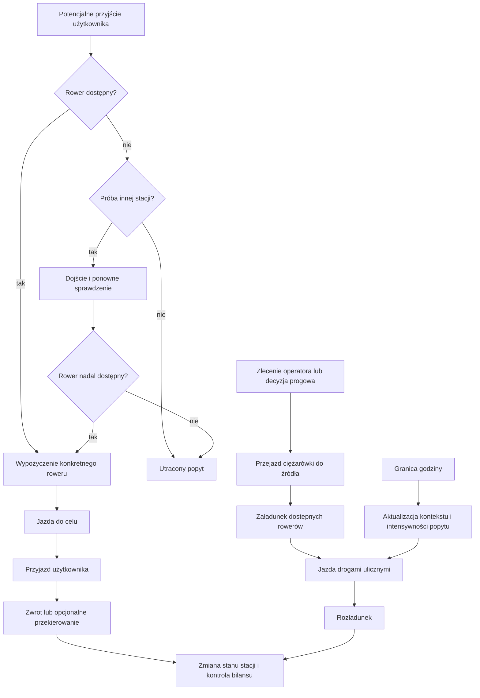

# Symulacja DES — kamień milowy 5 XI 2026

Implementacja: `src/simulation/`. Działa lokalnie w Pythonie 3.10 i nowszym, bez usług chmurowych. Jutrzejszy zakres obejmuje graf, silnik SimPy, użytkowników i ciężarówki, strategie `none`, `operator`, `threshold`, testy i wstępny eksperyment H3. Strategie nocna/predykcyjna, H5b i analiza wrażliwości pozostają na dalszy etap.

## Uruchomienie na Windows

W katalogu projektu:

```powershell
.\run_milestone.ps1
```

Skrypt przygotowuje lokalne `.venv`, dane `processed/`, wejścia, uruchamia testy i 360 symulacji. Gdy macierze są już zapisane, kolejne uruchomienie je wykorzystuje. Wyniki są w `results/h3/REPORT.md`. Pełny przebieg nie potrzebuje Internetu, jeśli środowisko i dane są już przygotowane.

Poszczególne kroki:

```powershell
python -m venv .venv
.\.venv\Scripts\python.exe -m pip install -r requirements-simulation.txt
.\.venv\Scripts\python.exe -X utf8 -m src.data.build --no-features
.\.venv\Scripts\python.exe -X utf8 -m src.simulation prepare --day 2026-11-03
.\.venv\Scripts\python.exe -X utf8 -m pytest -q
.\.venv\Scripts\python.exe -X utf8 -m src.simulation run --scenario threshold --trucks 2 --seed 1000
.\.venv\Scripts\python.exe -X utf8 -m src.simulation experiment --replications 30 --jobs 4
.\.venv\Scripts\python.exe -X utf8 -m src.simulation.verify --results results/h3
```

Dane w pełni przykładowe: `prepare --example --out results/example_inputs`, następnie `run --inputs results/example_inputs`. Odtworzenie grafów OSM, gdy brakuje `graph_drive.graphml`:

```powershell
.\.venv\Scripts\python.exe -X utf8 -c "import geopandas as gpd; from src.data.osm import _setup, fetch_graphs; from src.data.config import OSM_DIR; fetch_graphs(_setup(), gpd.read_file(OSM_DIR / 'boundary.geojson').geometry.iloc[0], print)"
```

`prepare` wykorzystuje rzeczywisty graf drogowy, jeśli istnieje. Bez grafu jawnie oznacza macierz ciężarówek jako przybliżenie geometryczne; `--approximate-roads` wymusza ten tryb. Eksperyment przekazany na 5 XI korzysta z rzeczywistych dróg OSM dla obu typów pojazdów. Macierze i graf stacji są zapisane w `results/inputs/network/`.

## Stan i równania

Czas wewnętrzny jest w minutach. Wszystkie daty zapisujemy w UTC; godziny popytu odnoszą się do `Europe/Warsaw`. Stan to listy obiektów `Bike(number)` na stacjach, słownik rowerów w przejazdach użytkowników, ładunki i pozycje ciężarówek, kolejka zleceń i zbiór stacji zarezerwowanych do relokacji.

Bilans w każdej chwili:

\[
B_0=\sum_i B_i(t)+B_{user}(t)+\sum_k B_{truck,k}(t),\quad B_i(t)\geq0,\quad B_{truck,k}(t)\leq Q.
\]

Miękka pojemność oznacza, że dopuszczamy `bikes > capacity`. Domyślna reguła zwrotu zawsze pozwala zostawić rower. Parametr `full_redirect_probability` umożliwia eksperyment z próbą znalezienia innej stacji; również wtedy ostateczny zwrot ma miękką pojemność.

Potencjalny popyt na stacji to niejednorodny proces Poissona o intensywności \(\lambda_i(t)\) w osobach/h. Model wywołujemy co godzinę i zamrażamy intensywność na godzinę; granice pierwszej i ostatniej godziny mogą być niepełne. Lewis–Shedler: kandydackie odstępy `Exp(M/60)` w minutach, przyjęcie z prawdopodobieństwem \(\lambda_i(t)/M\). Dla intensywności godzinowej \(M=\lambda\); funkcja `thinning` obsługuje też zmienną intensywność i sprawdza naruszenia ograniczenia.

Wstępna estymata:

\[
\widehat\lambda_{i,h}=\frac{\sum_{d<d_0}departures_{i,d,h}}{\max(1,\sum_{d<d_0}minutes\_available_{i,d,h}/60)}.
\]

Brakujące komórki mają zerową intensywność. OD: liczby historycznych przejazdów z wygładzaniem o łącznej wadze jednego pseudoprzejazdu na stację źródłową, proporcjonalnie do \(e^{-d_{ij}/3}\). To robocze modele wejściowe, wymagające zastąpienia modelami Osoby 2. Dane użyte do estymacji popytu i OD poprzedzają dzień scenariusza.

Użytkownik losuje cel z OD i dodatni mnożnik lognormalny:

\[
T_{ij}=\max(0.5,60d^{bike}_{ij}/v_b)\,L,\quad \log L\sim N(-\sigma^2/2,\sigma^2),\quad E[L]=1.
\]

Domyślnie \(v_b=14\) km/h i \(\sigma=0.4\). Przy pustej stacji 65% klientów podejmuje jedną próbę dojścia do najbliższej dostępnej stacji w promieniu 600 m, z prędkością 4.5 km/h; dostępność jest ponownie sprawdzana po dojściu. Tych parametrów jeszcze nie kalibrowano. E-rowery nie są osobną klasą w tym kamieniu milowym.

Ciężarówki mają pojemność 20 i obsługują każdy rower przez 0.25 min przy załadunku oraz przy rozładunku. Ich czas na odcinku jest liczony z oddzielnej macierzy drogowej i:

\[
v(t)/v_{free}=\max(0.05,1-\alpha\,congestion(t)).
\]

Wskaźnik z danych to `congestion = 1 - current_speed/free_flow_speed`, a nie mnożnik czasu. W trakcie jazdy co godzinę przeliczamy postęp w nowym kontekście. Kilometry obejmują jazdę do źródła bez ładunku i jazdę z rowerami. Macierz OSM korzysta ze skierowanych najkrótszych dróg, wraz z odcinkami dojścia od stacji do najbliższego węzła, przy swobodnej prędkości 25 km/h. Ograniczenia skrętów i rzeczywiste prędkości poszczególnych ulic nie są modelowane.

## Diagram zdarzeń



SimPy porządkuje jednoczesne zdarzenia deterministycznie. Proces użytkownika i proces ciężarówki nie modyfikują zapasu pomiędzy operacjami bez oddania sterowania; rower jest usuwany ze źródła dopiero po obsłudze załadunku, po ponownym sprawdzeniu dostępności.

## Strategie

- `none`: brak uruchomionych procesów ciężarówek; liczba zadeklarowanych pojazdów nie wpływa na wynik.
- `operator`: zachowuje kolejność, źródła, cele i zamówione liczby rowerów z `rebalancing_observed.parquet`. Zlecenia trafiają do fizycznych ciężarówek najwcześniej o zaobserwowanej porze; mogą się opóźnić, wykonać częściowo lub pozostać niewykonane do końca doby. Zlecenie większe niż pojazd jest dzielone. Godzina faktycznego przyjazdu wynika z jazdy i obsługi. Nie znamy rzeczywistych identyfikatorów ciężarówek, więc nie odtwarzamy ich faktycznych tras. Jest to odtworzenie ex post, nie prognoza polityki operatora.
- `threshold`: co 5 min wolny pojazd szuka pary z dawcą powyżej 50% i odbiorcą poniżej 50%; interwencja wymaga źródła >80% lub celu <20%. Priorytet ma największa różnica zapełnień, następnie krótsza droga. Zapas planowany do celu 50%, ograniczony stanem źródła i pojemnością pojazdu. Para stacji jest zarezerwowana do zakończenia zlecenia, co zapobiega podwójnemu planowaniu przez kilka ciężarówek.

Początkowe pozycje pojazdów to kolejne stacje w ustalonej kolejności. Flota startuje bez rowerów na pokładzie. Stacje zachowują tę samą inicjalizację we wszystkich strategiach i replikacjach.

## API i kontrakty z zespołem

```python
from src.simulation import run_simulation
from src.simulation.inputs import load_inputs

params = load_inputs("results/inputs", n_trucks=2, output_dir="results/custom")
result = run_simulation(params, "threshold", seed=123)
print(result.kpis)
print(result.paths["events"])
```

Funkcja przyjmuje `SimulationParams` albo słownik jego argumentów. Zwraca `SimulationResult` z tabelami oraz ścieżkami, jeżeli podano `output_dir`. Ponowne użycie tego samego `output_dir` nadpisuje pliki danego przebiegu; runner tworzy osobny katalog dla każdego scenariusza, floty i ziarna.

`demand_model.pkl` przechowuje model z metodą `rates(stations, context)` zwracającą jedną skończoną nieujemną intensywność w osobach/h dla każdej stacji, w kolejności tabeli stations. Model powinien deterministycznie korzystać z kontekstu i cech stacji. Wczytujemy wyłącznie zaufane lokalne pliki pickle. `od_matrix.npy` to macierz NxN w tej samej kolejności stacji; wiersze są normalizowane. Parametry użytkowników i jazdy są jawne w `SimulationParams`; można je podmienić bez przebudowy silnika.

Formaty wejść od Osoby 1 pozostają takie jak w `processed/`. Inicjalizacja bierze ostatni niepodejrzany pomiar sprzed startu, maksymalnie 15 min wstecz. Dla pięciu stacji bez obserwacji potrzebny był stan przykładowy; lista i liczba uzupełnień są w `metadata.json`. Te pięć historycznie nieaktywnych stacji ma zerowy popyt i jest wyłączone jako cel modelu OD.

Każdy przebieg zapisuje:

| Plik | Zawartość |
|---|---|
| `events.parquet` | dziennik zdarzeń: `time`, `minute`, `event`, `station_id`, `bike`, `request_id`, `truck_id`, pola specyficzne dla zdarzenia |
| `station_timeseries.parquet` | `time`, `station_id`, `bikes`, `docks`, `capacity`, `ebikes`, `ebikes_low`, `is_empty`, `is_overfull`, flagi jakości |
| `observed_timeseries.parquet` | alias stanów stacji w formacie wejściowym wizualizacji |
| `trips.parquet` | zakończone przejazdy użytkowników i rowerów przewożonych przez operatora; kolumny zgodne ze schematem `processed/trips.parquet` |
| `rebalancing_observed.parquet` | zakończone przewozy z numerami rowerów, źródłem, celem, czasem i odległością |
| `requests.parquet` | niezależny od strategii scenariusz potencjalnych klientów, z wylosowanym celem i mnożnikiem jazdy |
| `fleet_timeseries.parquet` | rowery na stacjach, w użyciu, na ciężarówkach i suma |
| `station_kpis.parquet` | dokładne minuty pustej i przepełnionej stacji oraz udział czasu pustego |
| `kpis.json` | zbiorcze KPI, niezakończone procesy i liczba kontroli bilansu |
| `stations.parquet`, `context_hourly.parquet` | dane opisowe do interpretacji i eksportu |

`events` jest dziennikiem zdarzeń, więc zawiera więcej informacji niż historyczna tabela zakończonych przejazdów; odpowiednikiem tej ostatniej jest `trips`. Identyfikatory syntetycznych rowerów mają prefiks `sim-`. E-rowery są na tym etapie oznaczone jako False/0. Przejazdy niezakończone do horyzontu są widoczne w dzienniku i bilansie, a nie w tabeli zakończonych przejazdów.

## Weryfikacja i eksperymenty

Testy odtwarzają stan z kolejnych zdarzeń i sprawdzają bilans, nieujemność zapasów, pojemność ciężarówek, deterministyczność, zgodność strumieni klientów, realny czas obsługi, miękką pojemność, alternatywne stacje, koniec doby, zerowy popyt i błędne wejścia. Test równoległego runnera porównuje wyniki z przebiegiem szeregowym.

Dla stałej intensywności testujemy liczby przyjść testem chi-kwadrat (przedziały o wystarczających oczekiwanych liczebnościach) i odstępy wykładnicze testem KS. Dodatkowy test sprawdza zmienną intensywność. Przypadek analityczny używa tego samego procesu użytkownika w jednej stacji z dwoma rowerami, powrotem do tej samej stacji i wstrzykniętymi wykładniczymi czasami obsługi. Liczba rowerów w użyciu jest procesem narodzin i śmierci M/M/2/2: \(\pi_n\propto a^n/n!\), \(a=\lambda/\mu=1.5\). Porównujemy udział pustej stacji i utracony popyt z \(\pi_2\), z tolerancją Monte Carlo. Zmieniamy rozkład jazdy tylko w teście analitycznym, nie w domyślnym modelu.

Runner wykonuje 30 niezależnych replikacji na wariant, ziarna 1000–1029. Wspólne liczby losowe są przypisane do stacji i konkretnego potencjalnego klienta przez SHA-256 i `SeedSequence`; dostępność roweru nie zużywa dodatkowych losowań. Warianty mają identyczne przyjścia, cele, mnożniki czasu i decyzje zachowania dla danego ziarna. Runner weryfikuje zgodność SHA-256 całych tabel requests.

Średnie i dwustronne 95% CI t-Studenta są liczone po replikacjach, także dla różnic parowanych. Test Wilcoxona jest dwustronny, używa obsługi zer Pratta, a p są korygowane metodą Holma w całej rodzinie porównań. Wszystkie zerowe różnice dają p=1. Front Pareto wyznaczamy dla średnich, minimalizując utracony popyt i km. Koszt stały ciężarówek nie jest częścią tego frontu.

KPI nie są wyznaczane z próbkowania co 5 min: czas pustki i przepełnienia całkujemy między każdą zmianą stanu, dodatkowy czas i kilometry cenzurujemy na końcu doby. Klienci nadal idący do alternatywnej stacji są `pending_users`, a niezakończone jazdy i ładunki pozostają w bilansie. To eksperyment skończonego horyzontu, bez rozgrzewki.

Dokumentacja bibliotek: [SimPy — sterowanie czasem i horyzontem](https://simpy.readthedocs.io/en/latest/topical_guides/environments.html), [OSMnx — grafy i najbliższe węzły](https://osmnx.readthedocs.io/en/stable/user-reference.html), [SciPy — test Wilcoxona](https://docs.scipy.org/doc/scipy/reference/generated/scipy.stats.wilcoxon.html).
