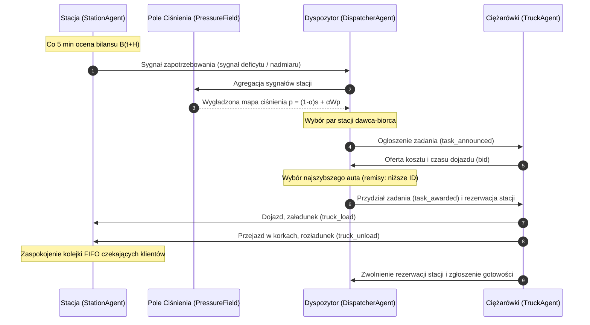

# Symulacja wieloagentowa (DES + ABM) — Silnik agentowy

Implementacja: `src/simulation/` oraz `src/agents/`. Architektura łączy symulację zdarzeń dyskretnych (DES w SimPy) z autonomicznymi agentami (ABM): stacje, ciężarówki i dyspozytor komunikują się ze sobą poprzez wiadomości i lokalne widoki, a globalne zachowanie systemu wyłania się ze sprzężeń zwrotnych.

## 1. Architektura agentowa i widoki lokalne

Zgodnie z zasadą „nikt nie widzi całego miasta”, agenci podejmują decyzje na podstawie ograniczonych, lokalnych widoków stanu:
- **Agent-Klient (`ClientAgent`)**: widzi wyłącznie stację początkową i ewentualnie opóźniony stan w aplikacji mobilnej (`AppView`).
- **Agent-Stacja (`StationAgent`)**: zna swój stan rowerów, kolejkę czekających oraz spodziewany bilans dostaw i zwrotów (`StationView`). Wylicza prognozę zapotrzebowania i wysyła sygnał histerezy.
- **Agent-Ciężarówka (`TruckAgent`)**: zna swoją bieżącą pozycję, ładunek, godziny zmiany pracy oraz aktualne zlecenie (`TruckView`).
- **Agent-Dyspozytor (`DispatcherAgent`)**: widzi zagregowane sygnały stacji i mapę ciśnienia, organizując przetarg zadań (Contract Net) wśród wolnych aut (`DispatcherView`).

## 2. Diagram sekwencji komunikacji (Contract Net)

## 3. Strategie dyspozytora

| Strategia | Zasada działania |
|---|---|
| `none` | Brak relokacji — zachowanie czysto pasywne. |
| `operator` | Odtworzenie historycznych zleceń operatora Veturilo z danych empirycznych. |
| `threshold` | Reaktywna reakcja progowa (interwencja poniżej 20% lub powyżej 80% pojemności). |
| `night` | Nocne wyrównywanie stacji (0:00–5:00) pod spodziewany poranny odpływ netto (6:00–10:00). |
| `predictive` | Predykcja wyprzedzająca: obsługa stacji prognozowanych jako puste/pełne za 30–60 min bez podglądania przyszłości. |
| `pressure` | Sterowanie polem ciśnienia: relokacje pomiędzy obszarami o skrajnych wartościach ciśnienia na grafie. |
| `operator_rule` | Heurystyka dopasowana do godzin pracy operatora (6:00–22:00) i progów 25%/75%. |

## 4. Pole ciśnienia na grafie stacji

Dyfuzja sygnału na grafie stacji zapobiega lokalnym oscylacjom i pozwala dyspozytorowi reagować na deficyty całych dzielnic:
- Wagi odległościowe: $w_{ij} = \exp(-d_{ij} / \ell)$ dla $d_{ij} \le 1.5$ km, znormalizowane w wierszach.
- Macierz $W$ obliczana jest jednokrotnie jako rzadka macierz CSR.
- Równanie dyfuzji:
  $$p \leftarrow (1 - \alpha) s + \alpha W p$$
  Dla $\alpha = 0$ otrzymujemy $p = s$.

## 5. Histereza sygnału stacji

Stacja wysyła sygnał deficytu przy prognozie $\hat{B} < 10\%$ pojemności, wyłączając go dopiero po przekroczeniu $25\%$. Sygnał nadmiaru aktywuje się powyżej $90\%$ i wyłącza poniżej $75\%$. Zapobiega to efektowi migotania (flicker).

## 6. Protokół ODD+D (Overview, Design concepts, Details + Decisions)

1. **Cel**: Zbadanie emergencji w miejskim systemie rowerowym (fale pustek, efekt stadny) oraz optymalizacja strategii relokacji rowerów przy ograniczeniach ruchowych (korki).
2. **Podmioty i zmienne stanu**:
   - Stacje: liczba rowerów, pojemność, kolejka FIFO czekających klientów, stan sygnału.
   - Ciężarówki: ładunek, pozycja, status zajętości, godziny zmian.
   - Klienci: typ użytkownika (commuter, student, leisure), dostęp do aplikacji, poziom cierpliwości, maksymalny dystans dojścia.
3. **Kolejność procesów**:
   - Aktualizacja zegara i kontekstu (godzina, pogoda, korki).
   - Generowanie potencjalnych klientów (proces Poissona z thinningiem).
   - Ewaluacja sygnałów stacji i pola ciśnienia co 5 minut.
   - Przetarg dyspozytorski Contract Net i przydział tras ciężarówkom.
   - Przejazdy użytkowników i ciężarówek z uwzględnieniem spowolnienia drogowego.
   - Rejestracja stanów i kontrola bilansu rowerów.

## 7. Weryfikacja i zestaw testów

Wszystkie testy wykonywane są za pomocą `pytest`. Pakiet obejmuje:
- `test_conservation_and_nonnegative_after_every_event`: Niezmiennik całkowitej liczby rowerów po każdym zdarzeniu.
- `test_conservation_multi_day`: Ochrona bilansu rowerów przez północ w symulacji wielodniowej.
- `test_contract_net_auction`: Poprawność licytacji najszybszego pojazdu i brak podwójnych rezerwacji.
- `test_contract_net_tie_breaking`: Deterministyczne rozstrzyganie remisów w ofertach (niższy numer pojazdu).
- `test_truck_shifts`: Przestrzeganie godzin zmian przez ciężarówki i dokończenie rozpoczętych zadań.
- `test_station_waiting_queue_fifo`: Obsługa kolejki oczekujących klientów w porządku FIFO i opuszczenie kolejki po wyczerpaniu cierpliwości.
- `test_pressure_field_diffusion`: Zgodność z sygnałem bazowym dla $\alpha=0$ oraz zanik wpływu wraz z dystansem.
- `test_hysteresis_no_flicker`: Brak migotania sygnału przy wahaniach wokół wartości progowych.
- `test_predictive_no_peeking`: Niezależność decyzji dyspozytora od przyszłych losowań klientów.
- `test_extreme_conditions`: Poprawne zachowanie w warunkach brzegowych (brak rowerów, brak popytu).
- `test_seed_reproducibility`: Pełna powtarzalność wyników przy zachowaniu tego samego ziarna losowego.
- `test_birth_death_single_station_analytic`: Zgodność ze wzorem analitycznym Erlanga/narodzin-śmierci M/M/2/2.
