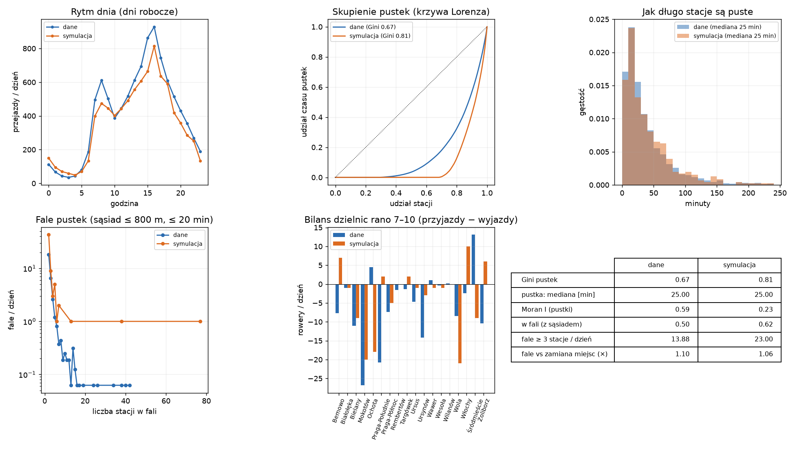

# Emergencja: pomiar zjawisk, których nikt nie zaprogramował

Wygenerowane przez `python -m src.metrics`. Wszystkie metryki liczone z tabel stanów co 5 min (dane: `observed_timeseries`, symulacja: `station_timeseries`), tylko pełne dni.

| metryka | dane | symulacja |
|---|---|---|
| dni | 16 | 1 |
| przejazdy / dzień roboczy | 9734 | 8593 |
| godzina szczytu | 16 | 16 |
| Gini pustek | 0.67 | 0.806 |
| 10% stacji = udział pustek | 0.44 | 0.58 |
| nigdy pusta | 0.277 | 0.678 |
| pustka: mediana [min] | 25 | 25 |
| pustka: p90 [min] | 90 | 92.5 |
| Moran I (pustki) | 0.589 | 0.228 |
| Moran p | 0.001 | 0.001 |
| chwile pustoszenia / dzień | 231 | 484 |
| w fali (z sąsiadem) | 0.498 | 0.616 |
| fale ≥ 3 stacje / dzień | 13.9 | 23 |
| największa fala | 42 | 77 |
| fale vs inny dzień (×) | 1.07 | nan |
| p (inny dzień) | 0.015 | nan |
| fale vs zamiana miejsc (×) | 1.1 | 1.06 |
| p (zamiana miejsc) | 0.000999 | 0.103 |

## Jak czytać

- **Gini pustek / 10% stacji**: skupienie czasu pustek na niewielu stacjach (H2).
- **Moran I**: czy stacje często puste leżą obok siebie (sąsiad ≤ 1 km, wagi standaryzowane wierszami; 0 = brak wzoru, > 0 = skupiska). p z 999 permutacji.
- **Fale pustek**: stacja pustoszeje, a w ciągu 20 min pustoszeje stacja do 800 m od niej; fala = spójny ciąg takich zdarzeń. „W fali” = udział chwil pustoszenia, które mają sąsiada w fali.
- **Modele zerowe** (czy fale to nie przypadek): *inny dzień* – dla każdej stacji jej chwile pustoszenia z losowego innego dnia tego samego typu (zachowuje porę dnia i częstość pustek, zrywa powiązanie z sąsiadami tego dnia); *zamiana miejsc* – stacje o podobnym udziale pustek (decyle) zamieniają się położeniem. „×” = dane / średnia modelu zerowego, p = (1 + liczba prób ≥ dane) / (1 + liczba prób).

## Testy fal: dane

| model zerowy | statystyka | dane | średnia modelu | 95% modelu | × | p |
|---|---|---|---|---|---|---|
| inny_dzien | linked_share | 0.499 | 0.468 | 0.491 | 1.07 | 0.015 |
| inny_dzien | n_cascades_ge3 | 222 | 210 | 231 | 1.05 | 0.206 |
| inny_dzien | mean_size_ge2 | 3.6 | 3.36 | 3.56 | 1.07 | 0.030 |
| zamiana_miejsc | linked_share | 0.499 | 0.454 | 0.473 | 1.10 | 0.001 |
| zamiana_miejsc | n_cascades_ge3 | 222 | 186 | 205 | 1.19 | 0.003 |
| zamiana_miejsc | mean_size_ge2 | 3.6 | 3.55 | 3.79 | 1.01 | 0.358 |

## Testy fal: symulacja

| model zerowy | statystyka | dane | średnia modelu | 95% modelu | × | p |
|---|---|---|---|---|---|---|
| inny_dzien | – | brak (za mało dni tego samego typu) | | | | |
| zamiana_miejsc | linked_share | 0.617 | 0.584 | 0.623 | 1.06 | 0.103 |
| zamiana_miejsc | n_cascades_ge3 | 23 | 31.4 | 39 | 0.73 | 0.978 |
| zamiana_miejsc | mean_size_ge2 | 4.52 | 3.89 | 4.53 | 1.16 | 0.058 |

